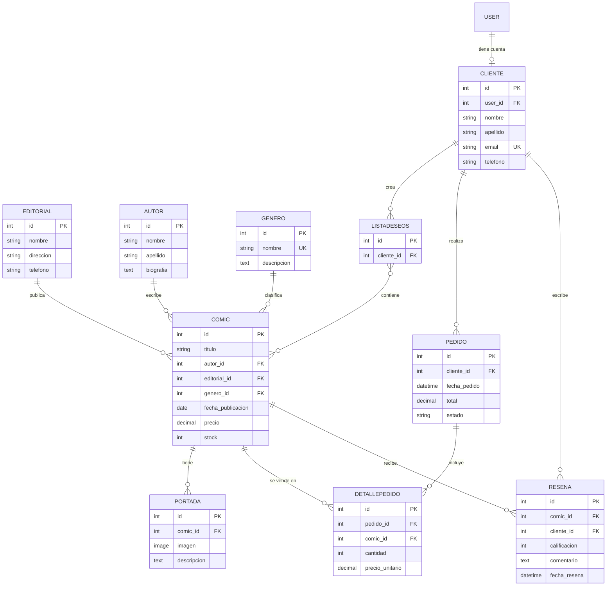

# 📚 ComicHouse

API REST de una **librería de comics**, hecha con **Django** y **Django REST Framework**.
Permite administrar comics, autores, editoriales, géneros, portadas, clientes, listas de deseos, pedidos y reseñas, y está pensada para conectarse con un frontend.

> Trabajo práctico de Django + DRF — Tecnicatura Superior en Desarrollo de Software, iTec Río Cuarto.

---

## 📖 Índice

1. [¿Qué es este proyecto?](#-qué-es-este-proyecto)
2. [Tecnologías](#-tecnologías)
3. [Capturas](#-capturas)
4. [Planificación de la base de datos](#-planificación-de-la-base-de-datos)
5. [Instalación paso a paso](#-instalación-paso-a-paso)
6. [Cómo usar la API](#-cómo-usar-la-api)
7. [Endpoints](#-endpoints)
8. [Filtros, búsqueda y paginación](#-filtros-búsqueda-y-paginación)
9. [Panel de administración](#-panel-de-administración)
10. [Estructura del proyecto](#-estructura-del-proyecto)
11. [Integrantes](#-integrantes)

---

## 🤔 ¿Qué es este proyecto?

Imaginá una librería de comics que quiere vender por internet. Necesita guardar *qué comics tiene*, *quién los escribió*, *quién es el cliente* y *qué compró*. Todo eso se guarda en una **base de datos**.

Una **API REST** es la "puerta" por la que otro programa (por ejemplo, una página web hecha en React) pide o envía esa información. En vez de mostrar páginas, la API responde con datos en formato **JSON**:

```json
{
  "id": 1,
  "titulo": "Batman: Año Uno",
  "precio": "8500.00",
  "stock": 12
}
```

Este proyecto es **solo el backend** (la parte que guarda y entrega los datos). El frontend se conecta a él mediante **CORS**, que es el permiso que le damos a otra página para hablar con nuestra API.

---

## 🛠 Tecnologías

| Herramienta | Para qué se usa |
|---|---|
| **Python 3.13** | Lenguaje del proyecto |
| **Django 6.1** | Framework web: base de datos, panel de administración, vistas |
| **Django REST Framework** | Convierte los modelos en una API (serializers, viewsets, paginación) |
| **SimpleJWT** | Login con tokens (JWT) |
| **django-filter** | Filtros en los listados (`?precio__lte=5000`) |
| **drf-spectacular** | Documentación automática (Swagger y Redoc) |
| **django-cors-headers** | Permite que un frontend se conecte a la API |
| **Pillow** | Manejo de imágenes (portadas de los comics) |
| **SQLite** | Base de datos (un archivo, no hay que instalar nada) |
| **uv** | Gestor de entorno virtual y dependencias |

---

## 📸 Capturas

> Reemplazá cada imagen por tu captura (guardalas en `docs/screenshots/`).

| Página de bienvenida | API navegable |
|---|---|
|  |  |

| Swagger | Redoc |
|---|---|
|  |  |

| Panel de administración | Filtros en la API |
|---|---|
|  |  |

---

## 🗂 Planificación de la base de datos

Antes de programar se pensó qué información necesita la librería y cómo se relaciona. El sistema tiene **10 modelos propios** (más el `User` que trae Django para el login).

### Diagrama entidad-relación



### ¿Qué significa cada modelo?

| Modelo | Qué representa | Se relaciona con |
|---|---|---|
| **Editorial** | La empresa que publica el comic (Marvel, DC...) | Tiene muchos `Comic` |
| **Genero** | Categoría del comic (superhéroes, terror...) | Tiene muchos `Comic` |
| **Autor** | Quien escribió el comic | Tiene muchos `Comic` |
| **Comic** | El producto que se vende | Pertenece a un `Autor`, una `Editorial` y un `Genero` |
| **Portada** | Imagen de tapa de un comic | Pertenece a un `Comic` |
| **Cliente** | Persona que compra | Está unido a un `User` (su cuenta de login) |
| **ListaDeseos** | Comics que un cliente quiere comprar más adelante | Pertenece a un `Cliente` y tiene muchos `Comic` |
| **Pedido** | Una compra completa | Pertenece a un `Cliente` |
| **DetallePedido** | Una línea del pedido ("2 unidades de Batman") | Une un `Pedido` con un `Comic` |
| **Resena** | Opinión y puntaje de un cliente sobre un comic | Une un `Cliente` con un `Comic` |

### Los tres tipos de relaciones usados

- **Uno a muchos (`ForeignKey`)**: *una* editorial tiene *muchos* comics. Es la más usada.
- **Muchos a muchos (`ManyToManyField`)**: una lista de deseos tiene muchos comics y un comic puede estar en muchas listas. En `Pedido` se resuelve con la tabla intermedia `DetallePedido`, que además guarda la cantidad y el precio.
- **Uno a uno (`OneToOneField`)**: cada `Cliente` tiene exactamente un `User` de Django.

### Estados de un pedido

`pendiente` → `procesando` → `enviado` → `entregado`

---

## 🚀 Instalación paso a paso

### Qué necesitás tener instalado

- **Python 3.13** o superior
- **[uv](https://docs.astral.sh/uv/)** (gestor de entornos). Instalación: `pip install uv`
- **Git**

### Pasos

**1. Clonar el repositorio**
```bash
git clone <URL-DEL-REPOSITORIO>
cd comicHouse
```

**2. Instalar las dependencias** (uv crea el entorno virtual solo)
```bash
uv sync
```

**3. Entrar a la carpeta del código**
```bash
cd src
```

**4. Crear la base de datos** (aplica las migraciones)
```bash
uv run manage.py migrate
```

**5. Crear un superusuario** (para entrar al panel de administración)
```bash
uv run manage.py createsuperuser
```
Te pide usuario, email y contraseña. Al escribir la contraseña no se ve nada en pantalla, es normal.

**6. Levantar el servidor**
```bash
uv run manage.py runserver
```

Listo. Abrí **http://127.0.0.1:8000/** en el navegador.

| Qué | Dirección |
|---|---|
| Bienvenida | http://127.0.0.1:8000/ |
| API navegable | http://127.0.0.1:8000/api/ |
| Swagger | http://127.0.0.1:8000/api/docs/swagger/ |
| Redoc | http://127.0.0.1:8000/api/docs/redoc/ |
| Administración | http://127.0.0.1:8000/admin/ |

> La base está vacía al principio. Cargá editoriales, autores, géneros y comics desde el panel de administración.

---

## 🔌 Cómo usar la API

### Autenticación

Casi todos los endpoints piden estar identificado. Hay tres formas:

**1) Registrarse** (no necesita login)
```bash
curl -X POST http://127.0.0.1:8000/api/registro/ \
  -H "Content-Type: application/json" \
  -d '{"username":"ana","password":"unaClave123","nombre":"Ana","apellido":"Pérez","email":"ana@mail.com"}'
```
Crea el usuario y su `Cliente` a la vez.

**2) Token JWT** (para frontend, Postman, etc.)
```bash
# Pedir el token
curl -X POST http://127.0.0.1:8000/api/token/ \
  -H "Content-Type: application/json" \
  -d '{"username":"ana","password":"unaClave123"}'
# → {"refresh": "...", "access": "eyJhbGciOi..."}

# Usarlo en cada pedido
curl http://127.0.0.1:8000/api/clientes/ \
  -H "Authorization: Bearer <access>"
```
El token `access` dura 5 minutos. Cuando vence, se renueva con `POST /api/token/refresh/` mandando el `refresh`.

**3) Sesión** — si iniciaste sesión en `/admin/`, el navegador ya queda identificado y la API navegable funciona directamente.

> ⚠️ Los usuarios que se crean por `/api/registro/` son **clientes**, no personal. No pueden entrar a `/admin/`, que solo admite usuarios con "Staff status".

### Quién puede qué

| Recurso | Sin login | Con login |
|---|---|---|
| Comics, géneros, detalles de pedido, reseñas | Solo leer | Leer, crear, editar, borrar |
| Editoriales, autores, portadas, clientes, listas de deseos, pedidos | ❌ | Leer, crear, editar, borrar |
| Registro | Crear cuenta | Crear cuenta |

### Acciones personalizadas (`@action`)

Además del CRUD normal hay dos endpoints especiales:

| Método | URL | Qué hace |
|---|---|---|
| `GET` | `/api/comics/sin_stock/` | Lista los comics sin stock |
| `POST` | `/api/pedidos/{id}/cancelar/` | Cancela un pedido |

---

## 📍 Endpoints

Todos cuelgan de `/api/`. Cada recurso permite: `GET` (listar), `POST` (crear), `GET /{id}/` (ver uno), `PUT/PATCH /{id}/` (editar) y `DELETE /{id}/` (borrar).

| Recurso | URL |
|---|---|
| Editoriales | `/api/editoriales/` |
| Autores | `/api/autores/` |
| Géneros | `/api/generos/` |
| Comics | `/api/comics/` |
| Portadas | `/api/portadas/` |
| Clientes | `/api/clientes/` |
| Listas de deseos | `/api/listas-deseos/` |
| Pedidos | `/api/pedidos/` |
| Detalles de pedido | `/api/detalles-pedido/` |
| Reseñas | `/api/resenas/` |
| Registro | `/api/registro/` (solo `POST`) |
| Token | `/api/token/` y `/api/token/refresh/` |
| Esquema OpenAPI | `/api/schema/` |

---

## 🔎 Filtros, búsqueda y paginación

### Paginación

Los listados devuelven **10 resultados por página**. Para cambiar de página: `?page=2`.

```json
{
  "count": 25,
  "next": "http://127.0.0.1:8000/api/comics/?page=2",
  "previous": null,
  "results": [ ... ]
}
```

### Filtros y búsqueda en comics

| Qué querés | Ejemplo |
|---|---|
| Título que contenga "bat" | `/api/comics/?titulo__icontains=bat` |
| Por autor | `/api/comics/?autor__nombre__icontains=frank` |
| Por editorial | `/api/comics/?editorial__nombre__icontains=dc` |
| Por género | `/api/comics/?genero__nombre__icontains=terror` |
| Precio menor o igual a 5000 | `/api/comics/?precio__lte=5000` |
| Precio mayor a 3000 | `/api/comics/?precio__gt=3000` |
| Con stock mayor a 0 | `/api/comics/?stock__gt=0` |
| Buscar en título, autor, editorial y género a la vez | `/api/comics/?search=batman` |

Se pueden combinar: `/api/comics/?genero__nombre__icontains=terror&precio__lte=5000`.

Terminaciones: `icontains` (contiene), `exact` (igual), `gt` (mayor), `gte` (mayor o igual), `lt` (menor), `lte` (menor o igual).

Otros recursos (editoriales, autores, géneros, portadas, clientes) permiten filtrar por sus campos, por ejemplo `/api/autores/?apellido=Moore`.

---

## 🛡 Panel de administración

En **http://127.0.0.1:8000/admin/** se puede crear, ver, editar y borrar cualquier dato sin usar la API. Los modelos tienen columnas visibles y búsqueda; los comics además tienen filtros por autor, editorial y género.

Para entrar hace falta un usuario *staff* (por ejemplo, el superusuario del paso 5).

---

## 🧱 Estructura del proyecto

```
comicHouse/
├── pyproject.toml        # dependencias del proyecto (uv)
├── uv.lock               # versiones exactas instaladas
├── .python-version       # versión de Python
├── README.md
└── src/
    ├── manage.py         # comandos de Django (runserver, migrate...)
    ├── db.sqlite3        # base de datos
    ├── settings/         # configuración del proyecto
    │   ├── settings.py   #   ajustes generales, DRF, CORS, JWT
    │   ├── urls.py       #   direcciones principales
    │   └── routers.py    #   registro de los endpoints de la API
    ├── productos/        # la app con toda la lógica
    │   ├── models.py     #   las tablas de la base de datos
    │   ├── serializers.py#   convierten modelos a JSON y viceversa
    │   ├── views.py      #   viewsets: qué hace cada endpoint
    │   ├── admin.py      #   configuración del panel de administración
    │   └── migrations/   #   historial de cambios de la base
    ├── templates/
    │   └── home.html     # página de bienvenida
    └── portadas/         # imágenes de portadas subidas
```

### Cómo se conecta todo

```
Pedido del frontend → urls.py → routers.py → ViewSet (views.py) → Serializer → Modelo → Base de datos
```

1. El pedido llega a una URL (`urls.py`, `routers.py`).
2. El **ViewSet** decide qué hacer (listar, crear, borrar...) y si el usuario tiene permiso.
3. El **Serializer** valida los datos y los convierte entre JSON y objetos de Python.
4. El **Modelo** guarda o lee en la base de datos.

---

## 👥 Integrantes

- Nombre Apellido
- Nombre Apellido
- Nombre Apellido
